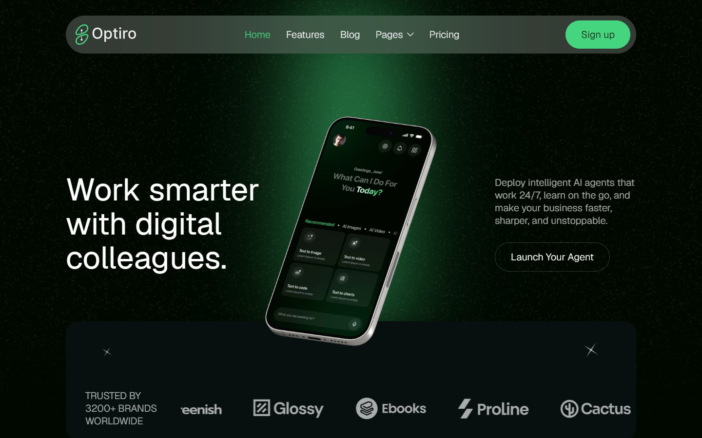

# Optiro – AI Agent Astro Theme



Optiro is a dark, modern theme for AI agent, chatbot and SaaS websites, built with [Astro](https://astro.build) 7. The blog is powered by [Strapi](https://strapi.io) 5, and the theme also works out of the box with bundled demo content.

**Live demo:** [optiro-astro-theme.vercel.app](https://optiro-astro-theme.vercel.app)

## Features

- Home page with animated hero, logo marquee, "how it works" steps, feature cards, testimonials, pricing and FAQ
- Features, Pricing, Contact, Blog, blog post, Style Guide and 404 pages
- Blog with a featured post, post pages and related posts, managed in Strapi CMS
- Works without a CMS: builds from the bundled demo posts
- Scroll, heading and hover animations with no framework runtime
- Fully responsive (desktop, tablet and mobile)
- SEO ready: titles, meta descriptions, Open Graph tags and canonical URLs
- Easy to customise from JSON config files

## Getting started

You need Node.js 22.12 or newer.

```sh
git clone https://github.com/Strockise/Optiro-Astro-Theme.git
cd Optiro-Astro-Theme
npm install
npm run dev
```

Open http://localhost:4321. The blog uses the demo posts until you connect Strapi.

### Commands

| Command           | Action                                       |
| :---------------- | :------------------------------------------- |
| `npm install`     | Install dependencies                         |
| `npm run dev`     | Start the dev server at `localhost:4321`     |
| `npm run build`   | Build the production site into `./dist/`     |
| `npm run preview` | Preview the production build locally         |

## Connecting Strapi (optional)

The Strapi project is in the `strapi/` folder.

```sh
cd strapi
npm install
cp .env.example .env
npm run seed
npm run develop
```

- Replace every `tobemodified` value in `strapi/.env` with a random string before you start.
- `npm run seed` loads the 7 demo posts and their images.
- Open http://localhost:1337/admin and create your admin user.

Then, in the theme root, copy `.env.example` to `.env`, set `STRAPI_URL=http://localhost:1337`, and run `npm run dev`. See [strapi/README.md](strapi/README.md) for permissions, API tokens and the Strapi MCP server.

### Environment variables

| Variable       | Required | Description                                                                           |
| :------------- | :------- | :------------------------------------------------------------------------------------ |
| `STRAPI_URL`   | No       | Strapi base URL, e.g. `http://localhost:1337`. If unset, the demo posts are used.      |
| `STRAPI_TOKEN` | No       | Read-only API token. Not needed if the Public role can read Blog entries.             |
| `SITE_URL`     | No       | Your production URL, used for canonical and Open Graph tags.                          |

### Blog content model

Strapi has one collection type, **Blog**, with these fields:

| Field             | Type           | Used for                                   |
| :---------------- | :------------- | :----------------------------------------- |
| `title`           | Text           | Post title                                 |
| `slug`            | UID            | Post URL: `/blog/<slug>`                   |
| `date`            | Date           | Publish date (posts are sorted by it)      |
| `authorName`      | Text           | Author shown on cards and posts            |
| `readTime`        | Text           | Reading time, e.g. "04 min"                |
| `isFeatured`      | Boolean        | Featured post on the blog page             |
| `image`           | Media          | Cover image                                |
| `content`         | Rich text      | Post body                                  |
| `metaDescription` | Long text      | SEO description                            |

The site is static, so rebuild it after you publish changes in Strapi. A Strapi webhook that calls your host's build hook can do this automatically.

## Project structure

```text
Optiro-Astro-Theme/
├── public/
│   ├── css/              # Theme styles (colours and fonts are CSS variables in optiro.css)
│   ├── js/               # Animation scripts
│   └── images/           # Images, favicons and Open Graph image
├── src/
│   ├── components/       # Navbar, Footer, CTA, FAQ, buttons, blog cards, SEO
│   ├── config/           # config.json, menu.json, social.json
│   ├── layouts/          # BaseLayout.astro
│   ├── lib/              # Strapi client, helpers
│   ├── pages/            # One file per route
│   └── content.config.ts # Blog content collection
├── strapi/               # Strapi CMS project
├── astro.config.mjs
└── package.json
```

## Customisation

| What                                   | Where                    |
| :------------------------------------- | :----------------------- |
| Site name, description, Open Graph image | `src/config/config.json` |
| Navbar, dropdown and footer links      | `src/config/menu.json`   |
| Social links                           | `src/config/social.json` |
| Colours, fonts and sizes               | `public/css/optiro.css`  |
| Contact form endpoint                  | `src/config/config.json` (`forms.contactAction`) |

**Contact form:** a static site has no form backend. Set `forms.contactAction` to the endpoint of a form service (Formspree, Basin, Getform…). The form then shows its success or error message.

**Animations:** elements animate through their `data-w-id` attribute and the `pageId` passed to `BaseLayout`. To remove an animation from an element, delete its `data-w-id` attribute and its inline `style`.

A detailed guide for adding pages, editing components and managing content is in [.agents/skills/astro-template-guidance](.agents/skills/astro-template-guidance/SKILL.md).

## Deployment

Run `npm run build` and deploy the `dist/` folder to any static host (Vercel, Netlify, Cloudflare Pages…).

- **Demo content:** leave `STRAPI_URL` unset.
- **Strapi content:** set `STRAPI_URL` (and `STRAPI_TOKEN` if you use one) in your host's environment variables. Strapi must be reachable during the build, and its images must be publicly accessible.
